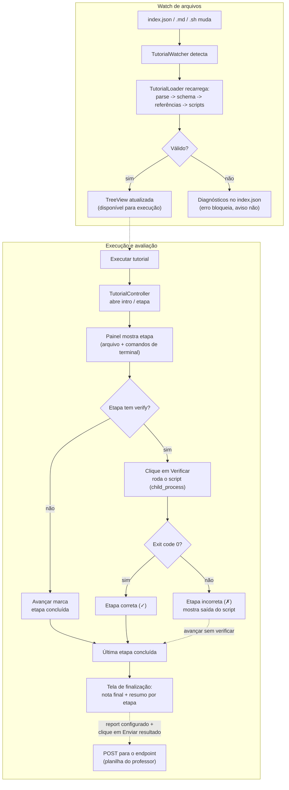

# Tutoriais Interativos de Microsserviços

Extensão do VS Code que detecta, valida, lista e executa tutoriais interativos
sobre padrões de microsserviços e observabilidade, definidos em um arquivo
`index.json` no repositório do tutorial.

Ao abrir uma pasta com um `index.json` válido, o tutorial aparece na aba
**Tutoriais Interativos** da Activity Bar, com título e etapas listados. Cada
etapa pode abrir um arquivo em uma linha específica, oferecer comandos de
terminal com um clique e ter uma avaliação automática (`verify`) que só roda
quando o botão **Verificar** é clicado. Alterações no `index.json` ou nos
arquivos `.md`/`.sh` referenciados revalidam o tutorial ao vivo. Ao final, se o
tutorial tiver um bloco `report`, o aluno pode enviar nome e nota para uma planilha do professor.

## Fluxos

**Carga e revalidação** — descoberta do `index.json` → parse posicional →
validação por schema → validação de referências e scripts → disponibilização
na TreeView. O `TutorialWatcher` repete esse fluxo sempre que um arquivo
relevante muda.

**Execução e avaliação** — o usuário inicia o tutorial, navega pelas etapas
(arquivo/terminal abrem automaticamente) e, em etapas com `verify`, clica em
Verificar para rodar o script de fato e obter nota/status.



## Formato do `index.json`

O arquivo precisa se chamar exatamente `index.json` e ficar na raiz do
tutorial. Todos os caminhos (`text`, `background`, `verify`, `file.name`) são
relativos ao diretório do `index.json`, com `/` como separador.

```jsonc
{
  "title": "Implementando o padrão CQRS",
  "description": "Separe leitura e escrita ...",
  "details": {
    "intro":  { "text": "intro.md" },
    "steps":  [ /* 1 ou mais etapas, na ordem */ ],
    "finish": { "text": "finish.md" }
  },
  "backend": { "imageid": "org/imagem:tag" }
}
```

| Campo | Obrigatório | Tipo | Descrição |
| --- | --- | --- | --- |
| `title` | sim | string | Título exibido na TreeView. |
| `description` | sim | string | Resumo curto do tutorial. |
| `details.intro` / `details.finish` | sim | _textBlock_ | Telas de introdução e finalização. |
| `details.steps` | sim | _step[]_ | Lista ordenada de etapas (mínimo 1). |
| `backend.imageid` | sim | string | Identificador do ambiente a provisionar. |
| `report` | não | _report_ | Envio do desempenho do aluno ao professor. |

**_textBlock_**: `text` (markdown, obrigatório) e `background` (script shell
opcional, roda automaticamente ao abrir a tela).

**_report_**: `endpoint` (URL `http(s)`, obrigatório) e `token` (texto
opcional, enviado junto ao registro). Veja
[Registro de desempenho](#registro-de-desempenho).

**_step_**: `title` e `text` (obrigatórios); `verify` (script `.sh` opcional,
avaliação automática da etapa); `file` (opcional, `{ "name", "line" }`, abre o
arquivo na linha indicada); `points` (inteiro ≥ 0, pontuação da etapa).

O schema é **estrito** (`additionalProperties: false`): propriedades não
previstas são rejeitadas, `steps` precisa ter ao menos um item, `points` e
`file.line` são inteiros e `file.line` começa em `1`.

Exemplo completo: [`examples/tutorial-cqrs/`](examples/tutorial-cqrs/).

## Convenção do `verify`

`verify` é uma **única** string por etapa apontando para um script `.sh` com
shebang `bash`/`sh`. Na autoria, a extensão só valida formato e sintaxe
(`bash -n`, sem executar); na execução, o script roda de verdade e seu exit
code decide o resultado — `0` é sucesso, qualquer outro valor é falha.

Para que o aluno veja uma mensagem útil em caso de falha, o script deve
imprimir a explicação **antes** do `exit` diferente de zero:

```bash
#!/usr/bin/env bash
set -uo pipefail

if [ ! -f src/order-service/projections.py ]; then
  echo "Esperado: arquivo 'src/order-service/projections.py' com o modelo de leitura (projeção)."
  exit 1
fi
echo "Etapa concluída."
```

Evite `set -e` sozinho quando o script tiver mais de uma checagem: ele encerra
no primeiro comando que falhar, antes do `echo` explicativo rodar. Prefira
`if`/`exit` explícitos, como acima.

`points` (inteiro ≥ 0) define a pontuação da etapa; a nota final soma os
pontos das etapas com `verify` aprovado sobre a soma dos pontos de todas as
etapas avaliáveis. Etapas sem `verify` não entram na nota e são marcadas
concluídas ao simplesmente avançar.

## Registro de desempenho

Com um bloco `report` no `index.json`, a tela de finalização ganha um formulário
com o campo **Nome** e o botão **Enviar resultado**. Nada é enviado sem
esse clique, e o formulário avisa o aluno sobre quais dados serão enviados.

```json
"report": {
  "endpoint": "https://script.google.com/macros/s/SEU_ID/exec",
  "token": "devops-2026-2"
}
```

`status` de cada etapa: `correct`, `incorrect`, `not-evaluated` (tem `verify`,
mas não foi verificada) ou `no-evaluation` (etapa sem `verify`).


O backend de referência é uma planilha Google com Apps Script, que guarda uma
linha por envio e uma aba de resumo por tutorial. Passo a passo em
[`docs/backend-planilha/`](docs/backend-planilha/README.md).

## Desenvolvimento

```bash
npm install
npm run build              # esbuild -> dist/extension.js
npm run watch               # esbuild em modo watch
npm run lint
npm test                    # testes unitários (tsc + mocha, sem VS Code)
npm run test:integration    # @vscode/test-electron (VS Code real)
npm run package              # gera o .vsix
```

Pressione **F5** no VS Code para abrir o _Extension Development Host_ com o
tutorial de exemplo carregado.

`@vscode/test-electron` baixa um VS Code real; em Linux headless (inclusive
WSL) instale as dependências gráficas uma vez:

```bash
sudo apt-get update && sudo apt-get install -y \
  xvfb libnss3 libnspr4 libasound2t64 libgbm1 libdrm2 libxkbcommon0 \
  libgtk-3-0t64 libatk1.0-0t64 libatk-bridge2.0-0t64 libcups2t64 \
  libatspi2.0-0t64 libxcomposite1 libxdamage1 libxfixes3 libxrandr2 \
  libxshmfence1 libpango-1.0-0 libcairo2 libx11-xcb1
```

(nomes de pacote do Ubuntu 24.04 "noble"; em versões anteriores use os mesmos
nomes sem o sufixo `t64`.) Sem `DISPLAY`, `npm run test:integration` se
reexecuta sob `xvfb-run` automaticamente — o CI já faz isso.

## Licença

MIT — veja [LICENSE](LICENSE).
